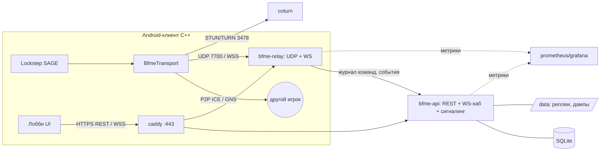

# SERVER-ARCH — сервер BFME1 Mobile для друзей (черновик v0.1, 02.10.2026)

Аудитория 5–30 человек. Один VPS, Docker Compose. Ничего не арендовано.
Пометки: [оценка], [не проверено]. Стек — Go (см. adr/ADR-NET-001-server-stack.md).

## 1. Компоненты
| Компонент | Что делает | Порты |
|---|---|---|
| caddy | TLS (Let's Encrypt), обратный прокси | 80, 443/tcp |
| bfme-api (Go) | REST: аккаунты, инвайты, матчи, реплеи, отчёты; WS-хаб: присутствие, лобби, чат, квикматч, ICE-сигналинг, MatchStart; админ-CLI `bfmectl` | внутр. 8080 |
| bfme-relay (Go) | UDP-релей + WS-fallback (`wss://…/relay`), авторизация по билету матча, fan-out, журнал команд, метрики | 7700/udp |
| coturn | STUN + TURN для ICE GNS (фаза 1), временные учётные данные через shared secret | 3478/udp+tcp, 49160–49200/udp |
| SQLite | БД (файл в volume `data`) | — |
| диск `/data/replays`, `/data/desync` | реплеи и дампы (zstd) | — |
| prometheus + grafana (профиль `obs`, по желанию) | метрики | только localhost/SSH-туннель |



## 2. Протоколы и API
- REST (JSON, HTTPS):
  - `POST /v1/auth/register {invite, nick, password}`
  - `POST /v1/auth/login`
  - `POST /v1/auth/refresh`
  - `GET /v1/me`
  - `GET /v1/matches?user=`
  - `GET /v1/replays/{match}`
  - `POST /v1/matches/{id}/replay` (multipart)
  - `POST /v1/matches/{id}/desync`
  - `POST /v1/matches/{id}/result`
  - `GET /healthz`, `GET /metrics` (внутренний)
- WS `wss://host/v1/ws` (protobuf, оболочка `Envelope{oneof}`): Auth, Presence, Lobby{Create, Join, Leave, Update, Ready}, Chat, Queue{Join, Leave}, MatchFound, MatchStart{match_id, slot, peers[], relay_endpoint, relay_ticket, match_key, ice_servers[], turn_cred}, IceSignal{to_user, match_id, blob}, MatchEndReport, ServerNotice.
- Сигналинг: хаб пересылает IceSignal только участникам того же match_id; блоб непрозрачен; лимит 64 КБ/с на клиента.
- Релей: формат пакета — NET-DESIGN §3.5. Типы HELLO(ticket), DATA, PING/PONG, BYE. Сессия по session_id из билета; адрес клиента обновляется по последнему пакету с верным AEAD (переживает смену IP). WS-fallback несёт те же кадры в бинарных сообщениях.
- Схема protobuf общая: клиент (C++, protobuf уже приходит с GNS через vcpkg) и сервер (Go).

## 3. Аккаунты и токены
- Регистрация только по инвайту:
  - код 10 символов base32, в БД хранится хэш;
  - параметры: max_uses, expires_at, автор;
  - создаёт админ (`bfmectl invite create`) или пользователь с квотой.
- Пароль хэшируется argon2id.
- Access JWT (EdDSA) на 15 мин; refresh-токен opaque на 30 дней, ротация, хранится хэш; на клиенте — Android Keystore (вопрос к Android-платформе).
- Билет матча: подписанный серверный токен {match_id, slot, user_id, exp} + match_key для AEAD релея и HMAC P2P. Учётные данные TURN временные (coturn use-auth-secret).
- Бан и отзыв: revoked_at у сессий, banned_at у пользователя.

## 4. Лобби, комнаты, квикматч
- Комнаты: хост, карта, режим, настройки, слоты (фракция/команда/цвет), ready. Старт возможен, когда все ready и build/data hash совпадают.
- Квикматч:
  - очереди 1v1 и 2v2;
  - подбор по рейтингу (Elo или Glicko-2, по желанию), окно ±100 расширяется на 50 каждые 10 с;
  - карты из пула.
  - При 5–30 игроках важнее «кто онлайн» и приглашения в комнату. Push-уведомления (FCM) — открытый вопрос.

## 5. Результат, реплеи, рассинхрон
- Результат:
  - каждый клиент шлёт MatchEndReport (победа/поражение по своей GameLogic, кадр, финальный CRC);
  - все совпали → результат принят;
  - расхождение → disputed (разбор админом по реплею);
  - выход засчитывается поражением, только если релей подтвердил, что игрок ушёл, и он не вернулся за PlayerTimeout (урок Arena 10.08.2026).
- Реплеи: два источника.
  1. Клиентский `.rep` выгружается автоматически после матча (как do_replay_upload у MZ).
  2. Журнал команд с релея.
  Хранится zstd по пути `/data/replays/YYYY/MM/<match>.rep.zst`, плюс sha256.
- Рассинхрон: отчёты всех участников группируются по match_id; `bfmectl desync show` и diff дампов; ссылки уходят QA.

## 6. Модель данных (SQLite, WAL)
Выбор: SQLite. Один файл, ноль администрирования, хватает для десятков записей в секунду; драйвер modernc.org/sqlite (чистый Go). Postgres — когда понадобятся несколько инстансов API. SQL пишем переносимый, миграции через goose.

```
users(id PK, nick UNIQUE, pass_hash, role, rating, created_at, invited_by FK, banned_at)
invites(id PK, code_hash UNIQUE, created_by FK, max_uses, uses, expires_at, revoked_at)
sessions(id PK, user_id FK, refresh_hash UNIQUE, device, created_at, expires_at, revoked_at)
lobbies(id PK, host_id FK, name, map, mode, settings_json, state, created_at)
lobby_members(lobby_id FK, user_id FK, slot, faction, team, color, ready, PK(lobby_id,user_id))
matches(id PK, lobby_id FK, mode, map, seed, build_hash, data_hash, started_at, ended_at, state[running|done|disputed|aborted])
match_players(match_id FK, user_id FK, slot, team, faction, result[win|loss|leave|unknown], reported_json, rating_before, rating_after, PK(match_id,user_id))
replays(id PK, match_id FK, uploader_id FK NULL, source[client|relay], path, size, sha256, frames, created_at)
desync_reports(id PK, match_id FK, user_id FK, frame, crc_local, crc_history_json, dump_path, build, device_json, created_at)
net_telemetry(match_id FK, user_id FK, ra_hist_json, stalls_json, rtt_p50, rtt_p95, loss, path_stats_json)
audit_log(id PK, actor_id, action, payload_json, at)
```

## 7. Админка, наблюдаемость, бэкапы
- Админ-CLI `bfmectl` (тот же бинарник, запуск через `docker compose exec`): invite create/list/revoke, user ban/unban/reset, match list/set-result, desync list/show. Веб-страница `/admin` только для чтения — позже.
- Логи — JSON (slog) в stdout, ротация docker.
- Метрики Prometheus:
  - ws_connections, lobby_active, match_active;
  - relay_pps, relay_bytes{dir}, relay_sessions, relay_path_switch_total, relay_auth_fail_total;
  - signaling_msgs, http_latency;
  - телеметрия матча из клиента: RA и фризы.
- Grafana — по желанию (профиль `obs`).
- Бэкапы:
  - ночью `VACUUM INTO` с проверкой `PRAGMA integrity_check`, локально 14 копий;
  - реплеи и дампы — rsync или restic во внешнее хранилище; куда именно — открытый вопрос (бесплатных вариантов без регистрации нет, решение за Андреем).
  - Тест восстановления — раз в месяц.

## 8. Деплой (Docker Compose на одном VPS)
- Сервисы: caddy, bfme-api, bfme-relay, coturn, профиль obs (prometheus, grafana). Volume: `data` (sqlite, replays, desync), `caddy_data`.
- Образы Go — distroless/static, один бинарник. Обновление: `docker compose pull && up -d`; WS-клиенты переподключаются сами, релей перезапускаем только между матчами.
- Фаервол: открыты 22 (только по ключу), 80, 443/tcp, 3478/udp+tcp, 49160–49200/udp, 7700/udp.
- Секреты (JWT-ключ, TURN secret) — в `.env` с правами 600, в git не попадают.

## 9. Требования к VPS
### 9.1 Трафик релея [оценка]
Допущения (NET-DESIGN §3.5): r ≈ 3,5 КБ/с на поток (30 пакетов/с × ≈115 Б). Худший случай: весь трафик идёт через релей (двойная отправка).
- Свой релей с fan-out: вход ≈ N·1,3·r (при N=2 — N·r), выход ≈ N·(N−1)·r.
- TURN (каждая пара отдельно): вход = выход = N·(N−1)·r.

| Матч | Длительность | Своя релей-нагрузка | За матч | TURN |
|---|---|---|---|---|
| 1v1 (N=2) | 20 мин | вход 7 + выход 7 = 14 КБ/с (112 кбит/с) | ≈17 МБ | ≈17 МБ |
| 2v2 (N=4) | 30 мин | ≈18 + 42 = 60 КБ/с (0,5 Мбит/с) | ≈108 МБ | ≈151 МБ |
| 4v4 (N=8) | 40 мин | ≈36 + 196 = 232 КБ/с (1,9 Мбит/с) | ≈0,56 ГБ | ≈0,94 ГБ |

Месяц: 10 матчей в день (50% 1v1, 35% 2v2, 15% 4v4) ≈ 130 МБ на матч в среднем → ≈40 ГБ в месяц. Пик: 3 одновременных 4v4 ≈ 6 Мбит/с.

### 9.2 CPU, RAM, диск [оценка]
- CPU: 4v4 ≈ 240 пакетов/с на вход и ≈1 700 на выход; 5 матчей ≈ 10 тыс. пакетов/с — доли одного ядра для Go-UDP. TLS/WS — мелочь. 2 vCPU с запасом.
- RAM: api 30–60 МБ, relay 20–50, coturn ~30, caddy 30–50, prometheus 150–300, grafana 100–200, ОС ~300 → 0,7–1 ГБ. 2 ГБ хватает, 4 ГБ — комфортно (плюс место под будущую проверку реплеев headless-движком).
- Диск: реплей ZH 25 КБ – 1,3 МБ (TheSuperHackers/GeneralsReplays). 300 матчей в месяц × ~0,3 МБ × 2 источника ≈ 0,2 ГБ + дампы ≈ 0,1 ГБ → <0,5 ГБ в месяц. 40–50 ГБ NVMe хватит на годы.

### 9.3 Локация и цены (открытые данные 02.10.2026, ничего не заказывалось)
Локация: Москва — ближе всего к игрокам в РФ, нет рисков оплаты и трансграничного UDP [не проверено].

| Провайдер | Конфигурация | Цена | Источник |
|---|---|---|---|
| Timeweb Cloud, Москва | 2×3,3 ГГц / 2 ГБ / 40 ГБ NVMe / 1 Гбит/с | 900 ₽/мес | https://timeweb.cloud/services/vps-linux |
| **Timeweb Cloud, Москва** | **2 vCPU / 4 ГБ / 50 ГБ NVMe / 1 Гбит/с** | **1 080 ₽/мес** + IPv4 150 ₽/мес (входит ли первый — [не проверено]) | там же |
| Timeweb Cloud-80 | 4 / 8 ГБ / 80 ГБ | 1 800 ₽/мес | там же |
| Selectel Standard Line, Москва/СПб | от 948,50 ₽/мес (конфигурация [не проверено]); 3 ТБ трафика и DDoS-защита бесплатно; цены vCPU +10% с 01.07.2026 | от 948,50 ₽ | https://selectel.ru/services/cloud/servers/ |
| Selectel HighFreq | 2 / 4 ГБ / 60 ГБ | 3 727 ₽/мес [агрегатор hosting.country, не проверено] | — |
| Hetzner, Хельсинки/Фалькенштейн | CX23 2 vCPU / 4 ГБ; CAX11 Arm 2/4 | €5,49 / €5,99 в месяц без НДС и IPv4, с 15.06.2026; оплата из РФ [не проверено] | https://docs.hetzner.com/general/infrastructure-and-availability/price-adjustment/ |

**Рекомендация:** Timeweb Cloud, Москва, 2 vCPU / 4 ГБ / 50 ГБ NVMe — ≈1 230 ₽/мес вместе с IPv4. Почасовой биллинг позволяет поднимать сервер только на время тестов Э5. Аренда — только с согласия Андрея.

## 10. Риски
- Мобильные операторы ограничивают UDP [не проверено] → WS-fallback через 443.
- Единственный VPS — единая точка отказа; для друзей это приемлемо, нужны бэкапы.
- Лицензия GeneralsOnline Services/клиента не проверена → не копируем.
- DDoS маловероятен (узкий круг), у Timeweb и Selectel заявлена защита.
